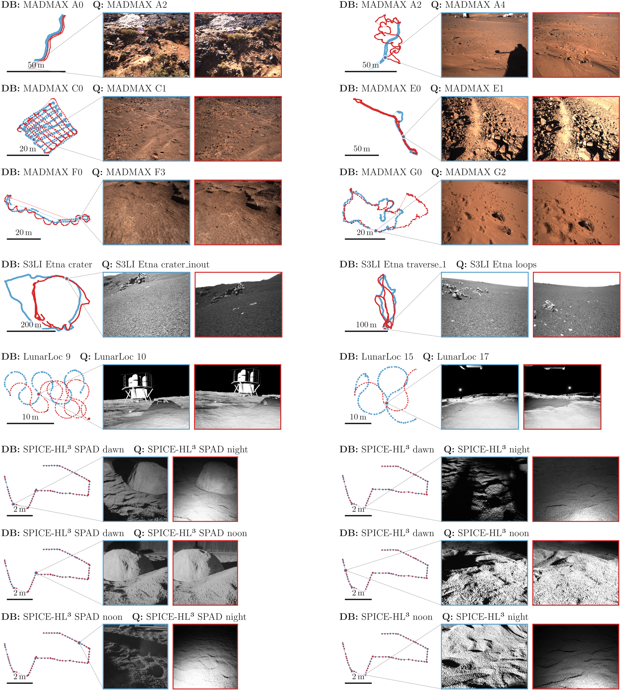

# VPR-Space

## About
Visual Place Recognition (VPR) is an important means for loop closure detection in visual Simultaneous Localization and Mapping (SLAM).
While state-of-the-art VPR and SLAM approaches show impressive results in urban and feature-rich natural environments, the vast, repetitive, and feature-poor environments of extraterrestrial surfaces like on the Moon or Mars, together with their challenging illumination conditions, pose severe challenges for  existing approaches. 

This repository is the data release of VPR-Space, a VPR benchmark evaluating VPR capabilities on extraterrestrial surfaces.

## Usage
Please see the github releases section of this repository. Download all files. To stitch the data back together, please navigate into the unpacked folder and:

```bash
cat vpr-space.tar.* | tar xvf -
```

## Overview


## Citation

Please cite VPR-Space and the works of previous authors we used to construct the benchmark:

```tex
% VPR-Space
@misc{fechner2026vprspacebenchmarkvisualplace,
      title={VPR-Space: A Benchmark for Visual Place Recognition in Space Analog Domains}, 
      author={Richard Fechner and Peer Neubert},
      year={2026},
      eprint={2610.35642},
      archivePrefix={arXiv},
      primaryClass={cs.RO},
      url={https://arxiv.org/abs/2610.35642}, 
}

% MADMAX
@article{meyer2021madmax,
  title={The MADMAX data set for visual-inertial rover navigation on Mars},
  author={Meyer, Lukas and Sm{\'\i}{\v{s}}ek, Michal and Fontan Villacampa, Alejandro and Oliva Maza, Laura and Medina, Daniel and Schuster, Martin J and Steidle, Florian and Vayugundla, Mallikarjuna and M{\"u}ller, Marcus G and Rebele, Bernhard and others},
  journal={Journal of Field Robotics},
  volume={38},
  number={6},
  pages={833--853},
  year={2021},
  publisher={Wiley Online Library}
}

% S3LI-Enta
@article{giubilato2022challenges,
  title={Challenges of slam in extremely unstructured environments: The dlr planetary stereo, solid-state lidar, inertial dataset},
  author={Giubilato, Riccardo and St{\"u}rzl, Wolfgang and Wedler, Armin and Triebel, Rudolph},
  journal={IEEE Robotics and Automation Letters},
  volume={7},
  number={4},
  pages={8721--8728},
  year={2022},
  publisher={IEEE}
}

% LunarLoc
@inproceedings{thomas2026lunarloc,
  title={LunarLoc: Robust Global Localization for Autonomous Surface Operations on the Moon},
  author={Thomas, Annika and Garbuz, Aleksander and Johst, Trevor and Srinivasan, Keerthana and Thomas, Dami and O'Neill, Cormac and Galliath, Robaire and Lordos, George and How, Jonathan P},
  booktitle={2026 IEEE Aerospace Conference},
  pages={1--11},
  year={2026},
  organization={IEEE}
}

% SPICE-HL³
@article{rodriguez2026spice,
  title={SPICE-HL3: Single-photon, inertial, and stereo camera dataset for exploration of high-latitude lunar landscapes},
  author={Rodr{\'\i}guez-Mart{\'\i}nez, David and Van Der Meer, Dave and Song, Junlin and Bera, Abhishek and P{\'e}rez-del-Pulgar, Carlos Jes{\'u}s and Olivares-Mendez, Miguel Angel},
  journal={Scientific Data},
  volume={13},
  number={1},
  pages={374},
  year={2026},
  publisher={Nature Publishing Group UK London}
}
```
